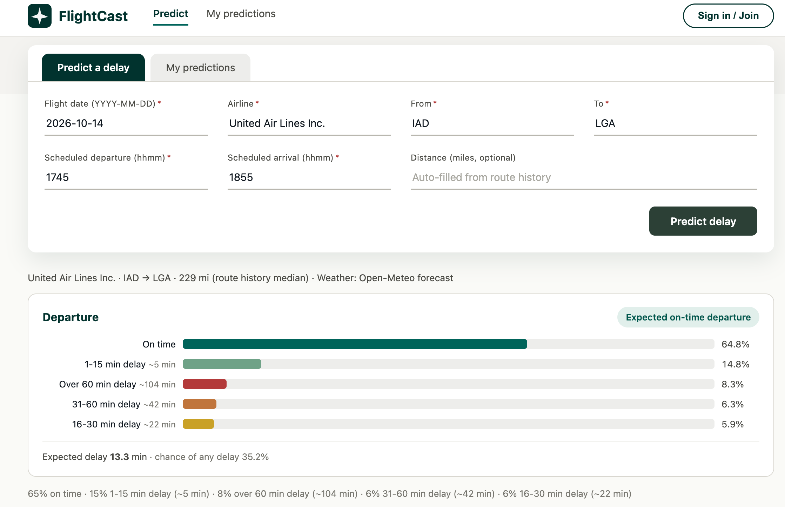
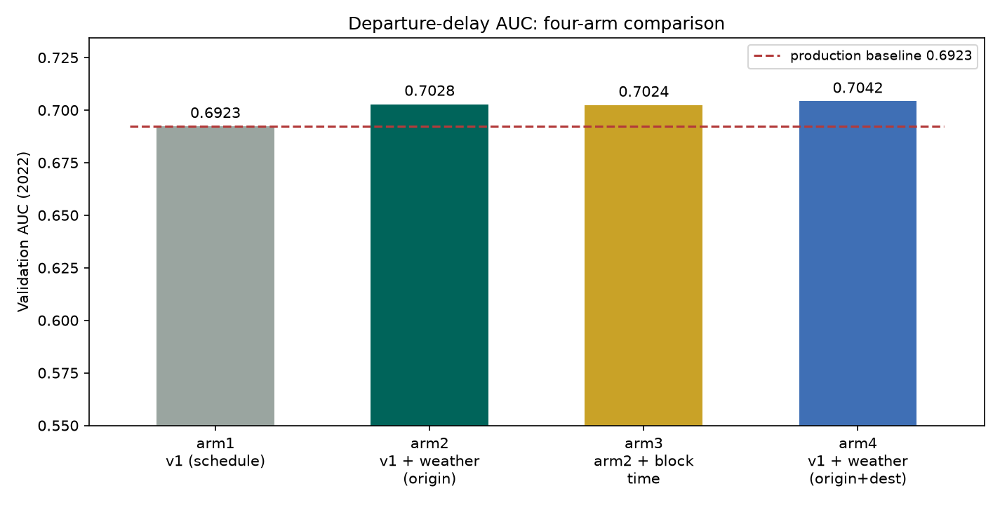
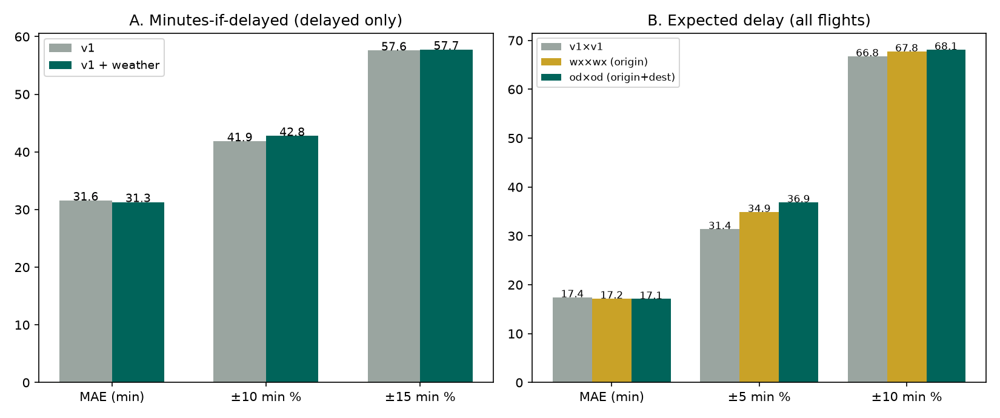
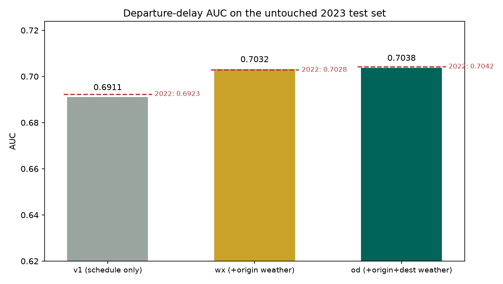
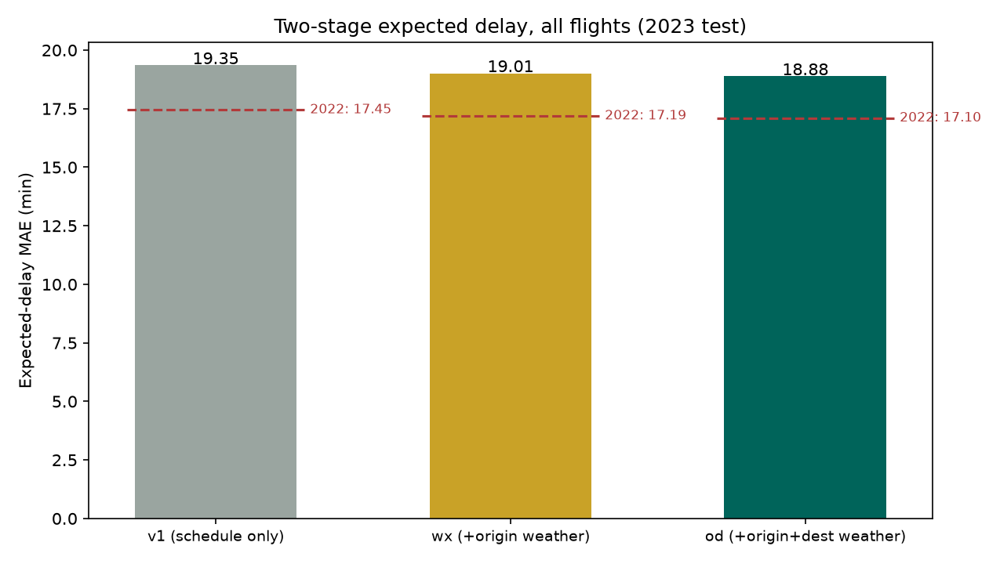
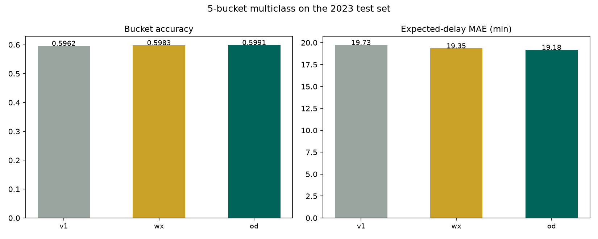
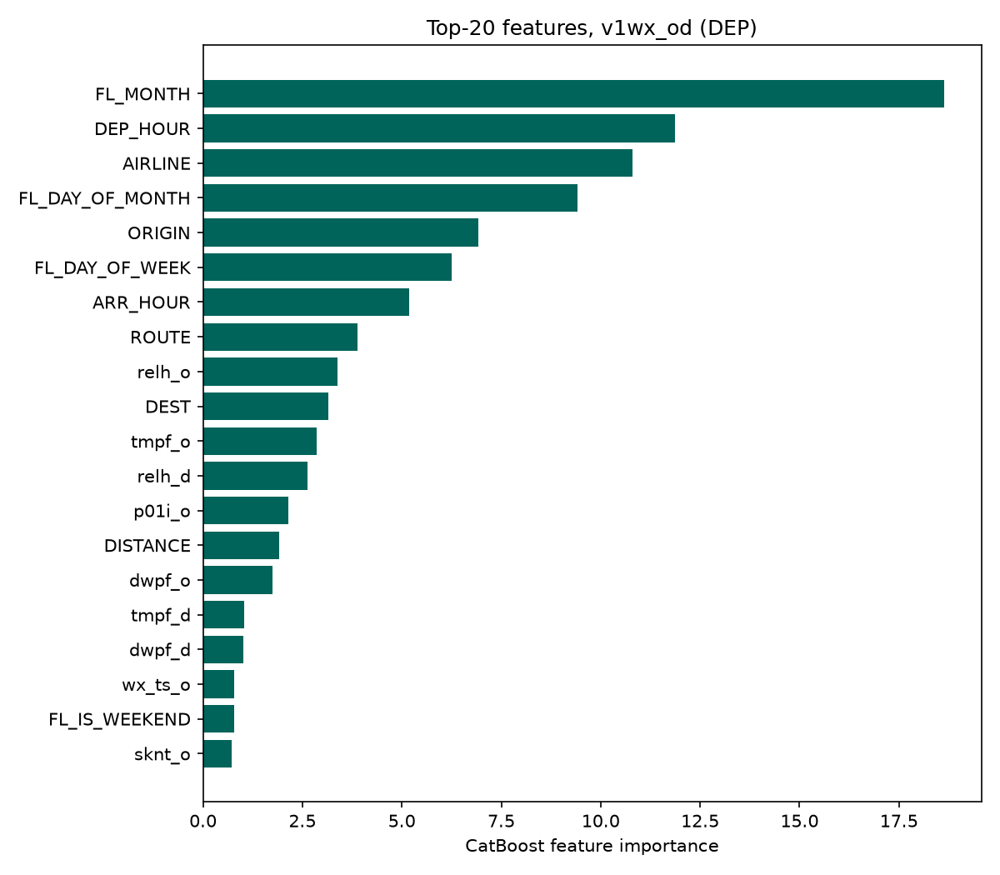

# IS6400 小组项目 · 航班延误预测 —— 完整项目记录

> FlightCast：预测美国国内航班**出发延误**的全栈应用（梯度提升模型 + Vue3/Flask）。
> 本文档完整记录：数据来源、字段与特征、模型训练方式、验证与测试结果、前后端实现，
> 以及我们**一步一步把验证集 AUC 从 0.6923 提升到 0.7042** 的全过程（含每一步的操作与对比）。
>
> 技术细节速查见 `flight_delay_model/README.md`；本文是面向复盘与报告的完整叙事版。

---

## 1. 项目概览

| 项 | 内容 |
|---|---|
| 任务 | 给定一趟未来航班（日期/航司/出发地/目的地/计划起降时刻/距离），预测**出发延误** |
| 产品输出 | ①延误概率 ②"若延误约几分钟" ③五档延误区间的完整概率分布（"63% on time · 25% 1-15 min (~5 min) · …"） |
| 最终模型 | 3 个 CatBoost 组件（二分类 / 五档多分类 / 回归），39 特征（计划 11 + 起飞机场天气 14 + 到达机场天气 14） |
| 最终成绩（2023 测试集，一次性收官） | **AUC 0.7038**，区间准确率 0.5991，两段式期望延误 MAE 18.88 分钟 |
| 部署 | Vue3 前端（国泰风格全英文）+ Flask 后端 + SQLite；线上天气由 Open-Meteo 免费预报 API 实时提供 |

线上效果（双端天气 + 三组件最终形态）：



---

## 2. 数据来源

### 2.1 航班数据（Kaggle 公开数据集）

- **文件**：`flights_sample_3m.csv` —— 3,000,000 行 × 32 列，美国国内航班 2019–2023
  （原始来源为美国交通部 BTS TranStats "Reporting Carrier On-Time Performance" 的公开抽样）。
- **完整性锚点**：原始文件 MD5 = `633c02070a85e801b6bf23d76acd3fdf`，行数/列数/字段清单
  记录于 `Dataset/data_manifest.json`；**原始数据永不修改**，清洗产物另存
  `flights_sample_3m_clean.csv`（3,000,000 行 × 20 列，由 `01_prepare_data.py` 生成）。
- **剔除字段及理由**（完整清单见 manifest）：
  - `DELAY_DUE_CARRIER / WEATHER / NAS / SECURITY / LATE_AIRCRAFT`：**标签泄露**
    （延误发生后的归因统计，预测时不存在）；
  - `CANCELLATION_CODE`、实际起降时刻、滑行时间等**运行后字段**：同为泄露；
  - `FL_NUMBER / DOT_CODE / ORIGIN_CITY` 等：与保留字段信息重复。
- **保留的 20 列**核心字段：`FL_DATE, AIRLINE, ORIGIN, DEST, CRS_DEP_TIME, CRS_ARR_TIME,
  DISTANCE, CRS_ELAPSED_TIME, DEP_DELAY, ARR_DELAY` 等。

### 2.2 天气数据（训练用实测）

- **来源**：Iowa Environmental Mesonet（IEM）ASOS/METAR 逐小时**实测**气象，
  按 380 个机场气象站逐站下载 2019–2023（脚本 `10_weather_download.py`，支持断点续传）。
- **覆盖**：380/380 机场全部成功（出发 ∪ 到达机场集合），整合为
  `weather/weather_hourly.csv.gz`（UTC 逐小时，162MB，不入库，可由脚本重建）。
- **下载过程中解决的真实问题**：
  - 42 个站按 IATA 直接查不到 → 需换 ICAO 站号；其中三个是机场改名/小站：
    `PBI→KDJT`（2026-08 该机场更名 DJT）、`USA→KJQF`、`WRG→PAWG`，其余 39 个逐一核实；
  - **机场时区推导**：数据集不含时区，我们用 `CRS_ELAPSED_TIME − 计划起降分钟差 ≈ −时差`
    从 300 万行航班时刻表反推每机场 UTC 偏移（以 ATL 为种子做一致性传播），
    再叠加夏令时规则（3 月第 2 个周日 ~ 11 月第 1 个周日）与 AZ/HI/PR/VI/GU 等不实行
    夏令时州的固定偏移修正——验证了 13 个已知机场全部正确；
  - 修掉一个隐蔽 bug：`hhmm` 时刻直接相减是错的（`2015−1830=185` 而非 105 分钟），
    必须先转分钟再运算。

### 2.3 线上服务数据

- **Open-Meteo 预报 API**（免费，无需密钥）：生成与训练 METAR **同构**的天气特征
  （单位在请求端直接换算为 °F/节/英寸/英里）；
- **OpenFlights airports.dat**：机场经纬度坐标（含改名机场手工兜底）。

---

## 3. 字段与特征

### 3.1 用户输入（7 个，与训练特征严格一致）

`FL_DATE`（日期）、`AIRLINE`（航司）、`ORIGIN`/`DEST`（机场）、`CRS_DEP_TIME`/`CRS_ARR_TIME`
（计划起降时刻 hhmm）、`DISTANCE`（英里，选填，后端自动回填）。

> 为什么预测出发延误还保留计划到达时刻：①它是模型特征 `ARR_HOUR` 的原料；
> ②到达侧天气必须按"到达机场@计划到达时刻"取样，这个字段是取样钥匙；
> ③两个时刻共同唯一定位一趟航班。距离对出发延误预测力弱但非零
> （到达侧天气加入后它成为"交互字段"），且模型训练时即包含，线上必须供给。

### 3.2 特征清单（最终 39 个）

| 组 | 特征 | 说明 |
|---|---|---|
| 计划 v1（11） | FL_MONTH, FL_DAY_OF_MONTH, FL_DAY_OF_WEEK, FL_IS_WEEKEND | 日期历法特征 |
| | DEP_HOUR, ARR_HOUR | 计划起降小时 |
| | DISTANCE | 航程英里 |
| | AIRLINE, ORIGIN, DEST, ROUTE | 类别特征（ROUTE=ORIGIN→DEST） |
| 起飞侧天气（14） | tmpf/dwpf/relh/sknt/gust/vsby/p01i/skyl1/skyc1_okta + 雷暴/雪/雨/雾标志 + 缺测标志 | 起飞机场@计划起飞时刻（UTC 对齐逐小时 METAR） |
| 到达侧天气（14） | 同上，`_d` 后缀 | 到达机场@计划到达时刻（跨夜航班自动 +1 天，夏令时按到达日期判定） |

### 3.3 目标定义

- 二分类：`DEP_DELAY > 0`（延误/未延误）；
- 五档多分类：≤0（准点）/ 1–15 / 16–30 / 31–60 / >60 分钟（`config.DELAY_BUCKET_EDGES`）；
- 回归：`DEP_DELAY` 连续分钟数（仅延误>0 子集训练，MAE 损失=中位回归）。

### 3.4 数据划分纪律（贯穿全程）

| 年份 | 用途 |
|---|---|
| 2019–2021 | 训练（约 179 万行） |
| 2022 | 验证：早停、调参、**所有**模型对比与采用决策（约 67 万行） |
| 2023 | **测试集，共评估过两次、均为纯评估且模型已冻结**：①v1 基线时代用 03 号出过基线报告（AUC 0.6911）；②收官用 `14_test_2023.py` 做三档消融终评（结果已定格，对同一存档拒绝重跑）。全程无任何训练/调参/模型筛选发生在 2023 上 |

---

## 4. 模型训练（最终三组件）

全部 CatBoost、全部 39 特征、全部只训练出发端（2026-10-08 导师建议聚焦单一任务后的项目口径）：

| 组件 | 脚本 | 配置 | 作用 |
|---|---|---|---|
| 二分类 | `11_train_weather.py` 臂4 | Logloss，lr 0.1，depth 8，`auto_class_weights=Balanced`，早停 150 | P(延误) |
| 五档多分类 | `12_train_bucket_weather.py` | MultiClass，lr 0.1，depth 7，**不用类别加权**（保持各档概率绝对值可信） | 五档概率分布 |
| 回归 | `13_train_regression_weather.py` | MAE 损失，lr 0.1，depth 8 | E[分钟 \| 延误>0] |

工程纪律：每个脚本支持**断点续训**（模型+metadata 已存在则跳过）；每次训练落盘
metadata（特征清单/超参/行数/库版本）、验证指标、图表与 Markdown 报告；
不修改生产指针，采用与否由人看完对照报告后决定。

---

## 5. 验证与测试结果

### 5.1 2022 验证集 · 二分类四臂对照（`11_train_weather.py`）

| 臂 | 特征 | AUC | 相对增益 |
|---|---|---|---|
| 臂1 v1 | 11 计划特征 | 0.6923 | — |
| 臂2 wx | +起飞机场天气 | 0.7028 | **+0.0105** |
| 臂3 +块时长 | 臂2+计划飞行时长/时差 | 0.7024 | −0.0004（无用，弃） |
| 臂4 od | +到达机场天气 | **0.7042** | +0.0014 |



### 5.2 2022 验证集 · 区间与回归（12/13 号，od 档 vs 上一代）

- 区间模型：准确率 0.6108、macro F1 0.1666、期望延误 MAE 17.44（对 08 无天气版胜 2/3 采用）；
- 两段式期望延误 MAE：v1 17.45 → 起飞侧天气 17.19 → **双端 17.10**；±5 分钟命中率 31.4%→36.9%。



### 5.3 2023 测试集 · 最终收官（`14_test_2023.py`，一次性）

三档消融同场对比，**六项指标排序全部保持 od > wx > v1，与 2022 验证值落差 ≤0.004 AUC
（无验证集过拟合迹象）**：

| 指标（2023 测试） | v1 仅计划 | wx +起飞天气 | **od +双端天气（线上）** |
|---|---|---|---|
| 二分类 AUC | 0.6911 | 0.7032 | **0.7038** |
| 区间准确率 | 0.5962 | 0.5983 | **0.5991** |
| 区间 macro F1 | 0.1506 | 0.1639 | **0.1696** |
| 期望延误 MAE(分) | 19.73 | 19.35 | **19.18** |
| 两段式 MAE(分) | 19.35 | 19.01 | **18.88** |
| 两段式 ±5min 命中 | 29.5% | 33.1% | **35.4%** |





完整报告与可复现指标：`flight_delay_model/models/20261013_133654_test2023/`。

---

## 6. 提升之路（编年复盘：我们如何从 0.6923 走到 0.7042）

### 第 0 步：诚实基线（2026-10-05，`02_train_models.py`）

CatBoost 与 LightGBM 各训练二分类+回归（v1 特征）：验证集 AUC
**CatBoost 0.6923 vs LightGBM 0.6898**（出发端），两算法基本持平，选定 CatBoost 为主力。
产物 `models/20261005_155440_final_gt0/`。

### 第 1 步：论证"调不动了"是特征问题，不是模型问题

在盲目换模型之前，我们做了三件事确认 0.69 附近是**计划特征的信息上限**：

1. **调参饱和实验**（`02b_tune_on_validation.py`，全程只用 2022 验证集）：
   网格轮换 depth/lr/l2，AUC 变动 < ±0.002——超参已饱和；
2. **消融实验**（`07_experiments_val.py`）：特征子集组合、早停策略等对照，
   结论"已到特征信息上限"；
3. **方法论讨论**：极值剔除（不改标签定义，弃）、聚类（树模型自带空间划分，弃）、
   换模型族（XGBoost 等，上限相同）——每项都有书面结论。

> 这一步的价值：后续所有提升都指向**新信息源**而不是炼丹，方向不会跑偏。

### 第 2 步：产品形态——五档概率输出（`08_train_bucket_models.py`）

课程要求输出"60% 不延误、25% 延误 1-15 分钟"式多情景概率 → 五档多分类。
验证集准确率 0.6090；同时落盘各档**训练集中位分钟数**（把"延误 16-30 分钟"翻译成
"约 22 分钟"的换算口径）。

### 第 3 步：被否决的方案——累积二分类（`09_train_cumulative.py`）

用 4 个链式 P(>k) 二分类器+单调投影重构五档：准确率 0.6086 vs 平版 0.6090、
校准 2.18pp vs 3.39pp（更好）、macro F1 略低——**1/3 胜，弃用保留平版**，
但"校准更好"的洞察写进报告。

### 第 4 步：修掉一次评估泄露（`06_eval_regression.py` 勘误）

发现旧两段式评估用**真实标签**筛选延误航班再算分钟（部署时不可知），
历史 MAE 12.93 是虚高。修正为"分钟预测覆盖全体航班"后诚实成绩：
v1 两段式 MAE **17.45**。README 留勘误记录。**教训：先审评估口径，再谈模型提升。**

### 第 5 步：范围决策——只做出发端（2026-10-08，导师反馈）

起飞+到达两个任务工作量过大，小组决定聚焦出发延误。训练脚本、后端、前端全部
改为仅出发口径；**保留两个计划时刻输入**（见 §3.1）。

### 第 6 步：路线 B——接入天气（最大的一次跃迁）

**决策**：数据集内已无干净增量信息（`DELAY_DUE_*` 是标签泄露，曾误信"不可用"的
其他 AI 结论后自行审计确认），把 AUC 推过 0.70 只能引入外部信息 → 天气。

**操作**：
1. `10_weather_download.py`：IEM ASOS 逐站下载 380 站 × 2019–2023，断点续传；
   解决 42 个站点 ID 问题（含 3 个机场改名，见 §2.2）；从时刻表反推机场时区；
2. `11_train_weather.py` 三臂对照（同一批行，公平对比）：
   **0.6923 → 0.7028（+0.0105）**，首次站上 0.70；块时长臂无增益被否决；
3. `12/13_train_*_weather.py`：区间与回归组件同步天气化。

诚实披露（写进报告）：训练用实测 METAR（文献标准做法），部署用 Open-Meteo 预报
（结构同构直接替换），真实场景增益会略小于实验值。

### 第 7 步：到达侧天气——GDP 假说（`11/12/13` 的 od 档）

**假说**（小组讨论提出）：目的地雷雨/大雾会触发 FAA **地面延误程序（GDP）**，
起飞机场天气良好的航班也被扣在地面——只看起飞侧看不见这类延误。

**操作**：
1. 到达侧天气无需新数据（380 站本就覆盖所有到达机场），新增 join：
   到达当地时刻=日期+(到达分钟<出发分钟?1天:0)+CRS_ARR_TIME，按到达机场/到达日期判 DST；
2. 11 号加第四臂 v1wx_od（39 特征）：**0.7028 → 0.7042（+0.0014）**；
3. 12/13 号重训 od 档：区间 macro F1 0.1629→0.1666，两段式 MAE 17.19→**17.10**。

**结论**：方向被数据证实、幅度小而一致（GDP 类延误占比小），三组件全部换装 od 档。



### 第 8 步：2023 收官（`14_test_2023.py`）

模型全部冻结后，在 2023 测试集上做三档消融终评（此前 v1 基线时代 03 号曾对基线出过
一次评估报告，同为纯评估、无决策回传；两次的 v1 AUC 完全一致 0.6911，互相印证）：
排序完全保持、漂移 ≤0.004 AUC，最终定格 **AUC 0.7038 / 两段式 MAE 18.88**。
至此 2023 成绩定格、线上即最终形态。

### 增益归因总账

| 步骤 | 验证集 AUC | 增量来源 |
|---|---|---|
| 基线 v1（CatBoost） | 0.6923 | 计划特征 |
| + 起飞机场天气 | 0.7028 | **新信息源（+0.0105）** |
| + 到达机场天气 | **0.7042** | 新信息源·GDP 机制（+0.0014） |
| 2023 测试（同配置） | 0.7038 | 分布漂移 −0.0004，稳健 |

---

## 7. 前后端实现

### 7.1 架构

```
Vue3 + Vite（国泰风格全英文）        Flask（Python）                 SQLite
┌────────────────────┐   POST /api/predict   ┌──────────────────┐   ┌─────────────┐
│ 预订卡式表单/五档图 │ ────────────────────> │ predictor_service│   │ flight_meta │ 航司/机场/航线元数据
│ 历史/登录           │ <──────────────────── │ verdict(argmax)  │   │ app.db      │ 用户+查询历史（独立）
└────────────────────┘      JSON 结果        │ weather_serving  │   └─────────────┘
                                              └──────────────────┘
                                                     │ Open-Meteo 预报（起飞侧+到达侧）
```

- **后端**（`server/`）：航司/机场模糊搜索、距离四级兜底（用户填→航线历史中位→
  出发机场中位→全局中位）、argmax 英文结论规则、PBKDF2 账号体系（24 万次迭代，
  仅标准库）、查询历史（仅登录用户、仅保存成功预测、仅本人可读）；
- **天气服务三级回退**（`server/weather_serving.py`）：预报取不到→天气缺测标志
  （模型照常预测）→组件失败→该组件沿用 v1→整体异常→完全回退 v1；
  按模型元数据自动识别是否需要到达侧预报；注册表 `models/wx_serving.json`
  控制组件开关与文件名（支持一行回滚）；
- **前端**（`frontend/`）：深绿主题、可搜索下拉（代码+名称单行、与输入框对齐）、
  五档概率条形图（色阶绿→红）、历史回放、可选登录；
- **测试**：`server/test_backend.py` 6 项后端测试 + 浏览器端到端验证
  （游客预测 / 注册登录 / 历史回看 / 登出）。

### 7.2 启动

```bash
cd flight_delay_model
python server/build_meta_db.py        # 首次：构建元数据库（约3秒）
cd frontend && npm install && npm run build && cd ..   # 改前端后重新构建
python server/app.py                 # http://127.0.0.1:5000
```

---

## 8. 复现指南（脚本一览）

| 脚本 | 作用 | 备注 |
|---|---|---|
| `01_prepare_data.py` | 清洗原始数据集（保留 20 列） | 只跑一次 |
| `02_train_models.py` | v1 基线（CatBoost/LightGBM × cls/reg） | 存档 20261005_155440 |
| `02b_tune_on_validation.py` | 验证集调参（结论：饱和） | |
| `03/04/05/06/07_*.py` | 评估/预测示例/可行性/回归评估/消融 | 06 含勘误说明 |
| `08_train_bucket_models.py` | 五档区间模型（无天气版） | |
| `09_train_cumulative.py` | 累积二分类（对照后弃用） | |
| `10_weather_download.py` | IEM 天气下载+时区推导 | 断点续传，380/380 |
| `11_train_weather.py` | 二分类四臂对照（v1/wx/block/od） | 产物含 auc_comparison 图 |
| `12_train_bucket_weather.py` | 区间模型 od 档（39 特征） | 双对照（08 版+上代天气版） |
| `13_train_regression_weather.py` | 回归 od 档 + 两段式三组合 | |
| `14_test_2023.py` | **2023 一次性收官评估** | 同存档拒绝重跑 |

依赖：`pip install pandas numpy catboost lightgbm scikit-learn matplotlib flask`
（数据集与模型二进制不入 git 仓库，按脚本重建）。

---

## 9. 仓库与协作说明

- 仓库为**私有**仓库，组员由仓库 owner 在 Settings → Collaborators 邀请（或
  `gh api repos/<owner>/IS6400/collaborators/<对方用户名> -X PUT`）；
- 不入库的大文件：原始/清洗数据集（CSV）、天气整合数据（csv.gz）、其余存档的模型二进制
  （.cbm/.txt，可按脚本重训）、`node_modules`、运行时数据库与密钥；
  **入库**：全部代码、每次训练的 metadata/指标/图表/报告（可追溯）、**线上在用的全套模型
  二进制（v1 基线 + od 档三组件，约 93MB，克隆即可跑网页）**、本文档；
- 关键可追溯锚点：原始数据 MD5（`Dataset/data_manifest.json`）、2023 测试纪律
  （`14_test_2023.py` 的 `--force` 门槛）、README 中的 06 号勘误记录。
