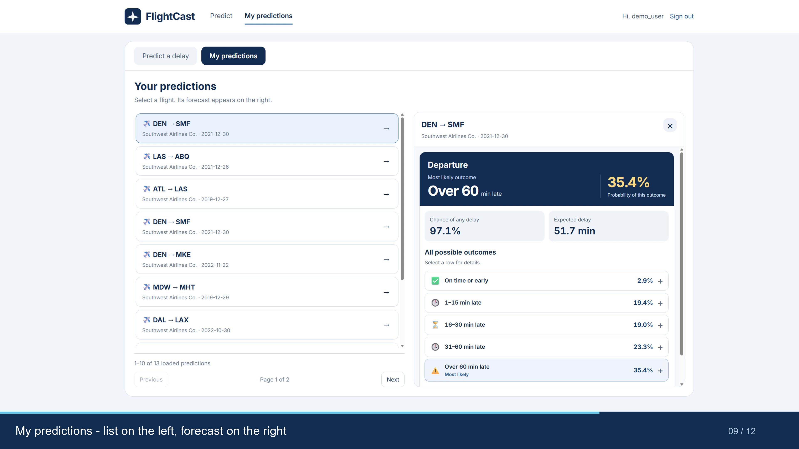

# FlightCast：五档单模型网页服务

本说明对应 2026-10-23 同步的版本。按照小组决定，网页后端只运行 **CatBoost 五档多分类 + 原 isotonic 校准器**；另外三个模型及历史基线保留原文件，停止在线加载和推理。前端继续展示原来同一来源的五档概率、结论和推导统计。

这是服务调用链的精简，没有重新训练、替换或删除模型。四个模型的训练工作、离线成绩和各自优势仍保留在 [项目记录](PROJECT_RECORD.md) 和 [技术手册](flight_delay_model/README.md) 中。

## 1. 当前启用什么

| 组件 | 当前状态 | 原存档 |
|---|---|---|
| 五档 CatBoost + isotonic | **唯一在线模型** | `20261013_122152_buckets_wx_dep` |
| 二分类 | 停用，文件保留 | `20261009_193645_wx_dep` |
| 条件回归 | 停用，文件保留 | `20261013_130457_wx_reg_dep` |
| 单段式回归 | 停用，文件保留 | `20261017_152303_improve` |
| 旧 v1 基线 | HTTP 入口不再调用，文件保留 | `20261005_155440_final_gt0`、`20261006_124341_buckets` |

当前五档模型文件为：

```text
flight_delay_model/models/20261013_122152_buckets_wx_dep/
├── mcls_dep_delay__v1wx_od__catboost.cbm
├── mcls_dep_delay__v1wx_od__catboost__metadata.json
├── isotonic_full2022.json
└── bucket_stats.json
```

配置位于 [wx_serving.json](flight_delay_model/models/wx_serving.json)：`serving_mode` 为 `bucket_only`，仅 `bucket_run` 非空，`cls_run`、`reg_run`、`cond_reg_run` 均为 `null`。`disabled_runs` 只记录原来的 run ID，不参与运行。

isotonic 是五档概率的校准层，不是另外一个独立预测模型。39 个输入特征和原校准器保持原样；本次核对的 14 个既有模型二进制均保持原字节内容。

## 2. 预测链和显示口径

```text
Vue 航班表单
    → POST /api/predict
    → 校验、航司/机场解析、距离回填
    → 原双端天气特征
    → 五档 CatBoost 一次推理
    → 原 isotonic 校准
    → 五档概率、主要结论、推导统计
    → 登录用户的成功预测写入自己的历史
```

| 页面 / 接口字段 | 当前来源 |
|---|---|
| 五档概率 `scenarios.dep_delay` | CatBoost 五档输出经过 isotonic 校准 |
| 主要延误范围 `verdicts.dep_delay` | 校准五档中概率最大的档位；同概率时选择较轻档 |
| `Chance of any delay` | `1 − 准时档概率` |
| `Expected delay` | `Σ(档位概率 × 档位典型分钟数)`，属于分档加权估计 |
| `predictions.dep_delay.prob_delay` | 同一校准分布推导，`prob_delay_source=calibrated-buckets` |
| `predictions.dep_delay.expected_minutes_overall` | 同一分档加权估计，`expected_delay_source=bucket-weighted` |
| `predictions.dep_delay.expected_minutes_if_delayed` | 五档条件分布推导，`conditional_minutes_source=bucket-derived` |

兼容字段继续返回，但不再代表三个已停用模型的独立输出。五档推导分钟数不能套用单段式回归的 MAE 成绩。选择当前在线方案是沿用既定页面口径、减少未展示模型的计算，不代表其他三个模型已被证明全面较差。

没有天气预报或日期超出预报范围时，使用原天气缺测特征继续预测；不会编造天气数值或延误原因。五档模型、配置或校准器故障时返回 **503**，不自动运行已停用模型，失败结果不保存。

## 3. 环境准备

本机验证环境为 Python 3.12、Node.js 24。需要项目元数据库 `server/flight_meta.db`；它与账号历史库 `server/app.db` 分开。原数据集和运行时账号库不提交到 GitHub。

在项目根目录（能看到 `flight_delay_model` 的这一层）创建 Python 环境并安装依赖：

```powershell
python -m venv .venv
& '.\.venv\Scripts\python.exe' -m pip install -r requirements-web.txt
```

将来源一致的 `flights_sample_3m.csv` 放到 `Dataset/`，再运行原准备脚本生成元数据库及本机路径配置：

```powershell
& '.\.venv\Scripts\python.exe' scripts/prepare_local.py --apply
```

准备脚本不训练模型。它兼容保留的历史存档，因此准备阶段检查文件数量不能当作每次预测的调用数量。详细数据来源、哈希核对及 Windows 配置见 [原上手说明](README.md) 和 [Windows 环境配置](Windows环境配置.md)。

安装前端依赖：

```powershell
cd flight_delay_model/frontend
npm ci
```

## 4. VS Code / PyCharm 终端启动

下面采用 Windows PowerShell，无需调用中文 CMD 文件。

**终端一：在项目根目录启动后端。**

```powershell
& '.\.venv\Scripts\python.exe' flight_delay_model/server/app.py
```

**终端二：在项目根目录进入前端后启动开发服务。**

```powershell
cd flight_delay_model/frontend
npm run dev
```

开发页面打开 `http://localhost:5173/`；前端通过 Vite 将 `/api` 代理到 5000。后端退出时，在启动它的终端按 Ctrl+C，再执行同一启动命令即可重启。

如果希望只启动一个后端进程来展示网页，先构建前端：

```powershell
cd flight_delay_model/frontend
npm run build
```

然后从项目根目录启动后端，打开 `http://localhost:5000/`。5000 托管构建后的 `dist`，5173 使用开发源码；修改界面后要重新构建，5000 才会显示对应更新。

## 5. 接口与历史记录

接口地址和必填输入继续保持原样：

| 接口 | 用途 |
|---|---|
| `GET /api/airlines`、`GET /api/airports` | 航司、机场搜索 |
| `POST /api/predict` | 新预测 |
| `/api/auth/register`、`login`、`logout`、`me` | 账号与会话 |
| `GET /api/history`、`GET /api/history/<id>` | 当前用户的历史列表与详情 |

预测输入示例（实际历史航班的计划信息，实际延误标签不作为模型输入）：

```json
{
  "FL_DATE": "2021-12-30",
  "AIRLINE": "Southwest Airlines Co.",
  "ORIGIN": "DEN",
  "DEST": "SMF",
  "CRS_DEP_TIME": 2245,
  "CRS_ARR_TIME": 25,
  "DISTANCE": 909
}
```

`DISTANCE` 可选，缺失时仍由后端按原规则回填。每个登录用户只能查看自己的记录；访客可以预测，但不读取或保存历史。已有记录显示保存时的结果，不自动重算。

确认当前只运行一个组件时，应检查**新发出的预测请求**，而不是旧历史快照：F12 → Network → `predict` → Response，`weather_components` 应为 `["bucket+iso"]`。Headers 中 `Server-Timing` 的 `dur` 是本次预测服务耗时，单位毫秒。

## 6. 开销与检查

原链路先运行 10 个历史基线再运行 4 个天气组件；本次同时绕过基线，避免仅停用三槽位后仍有额外模型运行。

| 本机固定条件对比 | 修改前 | 修改后 |
|---|---:|---:|
| 每次模型推理 | 14 次 | 1 次 |
| 热请求模型加载 | 每次 10 次 | 0 次，首次加载后复用 |
| 热请求耗时中位数 | 159.96 ms | 7.49 ms |
| 完成热请求后的测量进程工作集 | 172.59 MB | 116.90 MB |

以上来自同一航班、相同天气缺测特征、首次预测后各 20 次请求的独立进程实验，排除天气网络、HTTP 及历史写入等待。它不是全网页速度承诺，也不是模型准确率评估。对照航班的五档区块和 verdict 完全一致。说明见 [后端开销报告](BACKEND_PERFORMANCE.md)，原始测量见 [JSON 记录](docs/performance/serving-benchmark-20261022.json)。

在项目根目录测试当前版本：

```powershell
& '.\.venv\Scripts\python.exe' flight_delay_model/server/test_bucket_only.py
& '.\.venv\Scripts\python.exe' flight_delay_model/server/test_auth_history_api.py
& '.\.venv\Scripts\python.exe' flight_delay_model/server/test_backend.py
& '.\.venv\Scripts\python.exe' scripts/benchmark_serving.py
```

前端在 `flight_delay_model/frontend` 下运行 `npm run test:auth`。本次已通过 6 项单模型服务测试、29 项账号历史接口测试、6 项原后端测试及 11 项前端时序测试。

`benchmark_serving.py --compare` 需要原开发机保留的 `.local/bucket-only-before/` 快照；该私人备份不在仓库中。新克隆可不带 `--compare` 测当前版本，历史对比结果则查上面的 JSON 记录。

## 7. 演示

- [2K MP4：2560×1440](docs/demo/FlightCast-demo-2K.mp4)

视频为 44 秒、30 fps、无声、英文步骤字幕，由真实浏览器页面的高清截图按步骤剪辑，覆盖填写航班、预测、区间说明、登录、历史分屏、分页和退出。录制账号与数据库独立，预测来自当前真实模型，正式用户的历史不受影响。



## 8. 恢复其他模型时的注意事项

本版服务入口明确限制为五档模型。仅将停用槽位改成非空不会恢复多模型，会触发配置错误。将来确需恢复时，应显式调整服务编排和对应测试，并重新确认前端字段的统计含义。现有模型文件、训练脚本和评估报告已完整保留，可用于后续工作。
